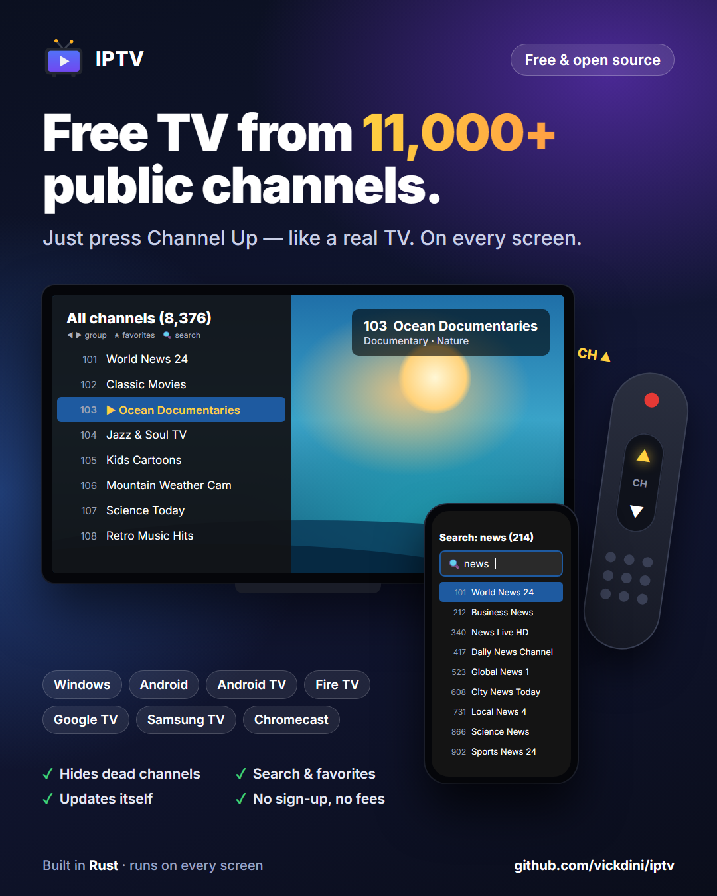

# IPTV

<p align="center">
  <a href="https://github.com/vickdini/iptv/releases/latest">
    
  </a>
</p>

<p align="center"><b><a href="https://github.com/vickdini/iptv/releases/latest">⬇ Download the latest version</a></b></p>

Watch free, publicly available IPTV channels like a TV: zap with Up/Down, type a
channel number, jump back to the previous channel, or pick from a scrollable
channel list. Channels that don't work are found automatically and hidden.

By default the app uses the public [iptv-org](https://github.com/iptv-org/iptv)
playlist, `https://iptv-org.github.io/iptv/index.m3u` (about 11,500 channels, of
which roughly three quarters work at any given time).

Runs on Windows, Android (phones, tablets, Android TV, Google TV, Fire TV) and
Samsung smart TVs, and can cast to Chromecast; Linux and macOS work from
source.

| Device | How to get it |
| --- | --- |
| Windows PC | [installer](#install-windows) |
| Android phone / tablet | [APK](#android) (can also cast to a Chromecast) |
| Android TV, Chromecast with Google TV, Google TV Streamer | [APK](#android-tv-google-tv-and-fire-tv) |
| Amazon Fire TV / Fire TV Stick | [APK](#android-tv-google-tv-and-fire-tv) |
| Older Chromecast (no remote) | [cast from the Android app](#chromecast) |
| Samsung smart TV (2019 or newer) | [Developer Mode install](#samsung-tvs) |

> [!IMPORTANT]
> **Disclaimer.** This project does not host, provide, sell or modify any
> streams or video content. By default it only loads the publicly available
> M3U playlist published by the iptv-org project, which links to channels
> that their broadcasters make freely available on the internet. The playlist
> is maintained by a third party; we do not control its contents.
>
> This project does not promote, encourage or support piracy or any other
> illegal activity. Do not use it to access content you are not legally
> allowed to watch in your country. If you load a different playlist (the
> `--playlist` option), you alone are responsible for making sure you have
> the right to watch what it contains.
>
> The software is provided "as is", without warranty of any kind (see sections
> 15 and 16 of the [license](LICENSE)). The authors and contributors are not
> responsible for how anyone uses it, or for any damage or legal consequences
> arising from its use.

## Install (Windows)

**[Download the latest installer](https://github.com/vickdini/iptv/releases/latest)**
(`IPTV-Setup-<version>.exe` under *Assets*) and run it. It's a single
installer with everything included (the app and its video engine). Nothing
else needs to be installed. It:

* installs for the current user only, without asking for administrator rights
* adds a Start-menu shortcut and, optionally, a desktop icon
* can be removed from *Settings → Apps* like any other program

The app opens maximized and starts playing straight away.

The installer isn't code-signed yet, so Windows SmartScreen may say *"Windows
protected your PC"*. Click **More info → Run anyway**. Every installer is
built from this repository's source by GitHub Actions (see the
[workflow](.github/workflows/release.yml) and its run logs). To verify your
download, compare its SHA-256 with `SHA256SUMS.txt` on the release page:

```powershell
Get-FileHash IPTV-Setup-*.exe -Algorithm SHA256
```

## Android

The Android app (phones, tablets and Android TV, Android 7.0 or later) has the
same features: the latest playlist on every launch, dead channels hidden
automatically, channel numbers, groups and favorites. It plays in landscape,
full screen.

| Phone / tablet | Android TV remote | Action |
| --- | --- | --- |
| swipe up / down | Up / Down, Channel +/- | next / previous channel |
| tap | OK | open / close the channel list |
| double-tap | Backspace, Last channel | previous channel |
| long-press | Info | channel info |
| | Left / Right | previous / next group |
| | 0–9 | go to channel number (OK to confirm) |
| | Fast-forward / Rewind, Next / Previous | next / previous channel |
| | Play/Pause, Menu | open / close the channel list |
| | Bookmark | toggle favorite |

The channel list has a **Search channels…** box at the top (phone keyboard,
or the TV's on-screen keyboard: Up from the first channel reaches it).

On phones and tablets, the ⏻ button in the channel list header exits the app
(it also stops casting).

In the channel list: tap (or OK) watches a channel, long-press toggles a
favorite, and the ◀ ▶ ★ buttons switch group / favorites only.

**[Download the latest APK](https://github.com/vickdini/iptv/releases/latest)**
(`IPTV-<version>.apk` under *Assets*) on the phone or TV and open it. Android
asks once to allow installing apps from your browser or file manager; allow
it, then tap **Install**. The app isn't on Google Play, so Play Protect may
show a warning for an unknown developer; choose **Install anyway**. Updates
are installed the same way, over the previous version.

The APK is built and signed by GitHub Actions from this repository's source.
Its signing certificate (`CN=IPTV, O=vickdini`) has the SHA-256 fingerprint
`4A:40:E4:CA:75:E2:C2:5E:0A:BC:77:4B:EE:33:02:34:A3:87:1D:7D:CB:8C:FE:A7:66:A5:7A:C6:DD:34:14:61`.

### Android TV, Google TV and Fire TV

The same APK runs on TV devices: it appears in the TV's app list with its own
banner and is controlled with the remote. TV stores don't offer it, so it is
"sideloaded" once:

* **Fire TV / Fire TV Stick:** *Settings → My Fire TV → Developer options →
  Install unknown apps* → turn on **Downloader** (install the free
  *Downloader* app from the Amazon store first). In Downloader, enter
  `https://github.com/vickdini/iptv/releases/latest`, download
  `IPTV-<version>.apk` and install it.
* **Chromecast with Google TV / Google TV Streamer / Android TV:** install
  *Downloader* from the Play Store, allow it under *Settings → Apps →
  Security & restrictions → Unknown sources*, then download and install the
  APK the same way. (Or: `adb connect <tv-ip>` then `adb install IPTV-<version>.apk`.)

These remotes usually have no number or channel keys: use Up/Down to zap,
Fast-forward/Rewind as channel +/−, and OK or Play/Pause for the channel list.

### Chromecast

Older Chromecasts (the plain dongle without a remote) can't install apps;
cast to them from an Android phone or tablet instead: open the channel list
and tap the Cast button, then choose the Chromecast. Zapping on the phone
changes the channel on the TV. Casting uses Google's built-in receiver, which
plays streams in a web browser on the Chromecast, so channels whose servers
don't allow that (CORS) or that need a special user agent can't be cast;
they are skipped automatically.

## Samsung TVs

Samsung TVs (Tizen) can't install apps from a download or a USB stick: only
from the Samsung store, or from a PC with the TV in **Developer Mode**, signed
with a free Samsung certificate made for that TV. The app works on Samsung
TVs from 2019 on.

**One-time setup (on a Windows PC on the same Wi-Fi as the TV):**

1. Install the [Tizen Studio](https://developer.tizen.org/development/tizen-studio/download)
   command-line tools (`web-cli_Tizen_Studio_*_windows-64.exe`), then in its
   Package Manager install **Samsung Certificate Extension** and
   **TV Extensions Tools** (*Extension SDK* tab).
2. On the TV: open **Apps**, enter **1 2 3 4 5** with the remote (or the
   on-screen number pad), switch **Developer mode** on, enter the PC's IP
   address, and restart the TV.
3. Download `IPTV-Samsung-TV-<version>.zip` from the
   [latest release](https://github.com/vickdini/iptv/releases/latest) and
   unzip it.
4. Run, with your TV's IP address (*Settings → General → Network → Network
   Status*):

   ```powershell
   powershell -ExecutionPolicy Bypass -File install-on-tv.ps1 -TvIp 192.168.1.4
   ```

   The first time, it explains how to create the Samsung certificate in
   Tizen's Certificate Manager (sign in with a Samsung account; the TV's ID
   is filled in automatically while it's connected). Run it again afterwards
   and it signs and installs IPTV, which then appears in the TV's Apps.

| Remote | Action |
| --- | --- |
| Up / Down, CH + / CH − | next / previous channel |
| 0–9 | go to channel number |
| OK | channel list (in the list: watch the selected channel) |
| Left / Right | previous / next group |
| PRE-CH | previous channel |
| INFO | channel info |
| Red / Green / Yellow | favorite / favorites only / help |
| Blue (or Up from the first channel in the list) | search by name with the on-screen keyboard |
| Back | close the list, or exit |

## Using it

### Remote control (in the player window)

| Key | Action |
| --- | --- |
| Up / Down, PgUp / PgDn, mouse wheel | channel up / down |
| 0–9, then wait 2 s or press Enter | go to channel number |
| Backspace | previous channel |
| Left / Right, m | volume, mute |
| l / Tab / right-click | open / close the channel list |
| / or Ctrl+F | search channels by name (see below) |
| g / G | next / previous group (Movies, News, Sports…) |
| s / S | toggle favorite / zap only through favorites |
| i | channel info |
| f, double-click | fullscreen (Esc leaves it) |
| h / ? / F1 | help |
| q | quit |

### Channel list

`l` opens a scrollable list of every working channel in the current view (all
channels, or the selected group / favorites) on the left of the window. The
video keeps playing beside it.

| Input | Action |
| --- | --- |
| mouse wheel | scroll (Shift+wheel: a page) |
| hover / Up / Down / PgUp / PgDn / Home / End | select |
| click / Enter | watch the selected channel (the list stays open) |
| click on the scrollbar | jump to that part of the list |
| g / G, S | switch group / favorites only (the list follows) |
| s | toggle favorite on the selected channel |
| 0–9 | go to channel number |
| Esc / l / click on the video | close |

### Searching

Type part of a channel name to see only the matching channels: case and
accents don't matter ("tele" finds "Télé") and every word must appear, in
any order ("cnn int" finds "CNN International"). The results work like a
group: the list shows them and Channel Up/Down zaps through them (the banner
shows `[Search: …]`). Switching group or favorites ends the search.

On Windows: press **/** or **Ctrl+F**, type, **Enter** to pick from the
results with the arrows, **Esc** to clear the search. Backspace deletes.

The channel being watched is marked ▶; favorites are marked ★.

### Channel numbers

Channel numbers are positions in the playlist. Hidden (non-working) channels
leave gaps instead of renumbering the others, so a channel's number doesn't
depend on which other channels happen to be online. Numbers can shift when the
upstream playlist changes. The last channel and favorites are remembered by
stream address, so they survive such changes.

## How it works

### Always the latest playlist

On every launch the app asks the playlist server whether the playlist has
changed since the copy it saved last time (an HTTP conditional request using
`ETag` / `Last-Modified`).

* **Unchanged:** the server sends no data (≈60 ms) and the saved copy is used.
* **Changed:** the new version (≈2.6 MB) is downloaded and saved.
* **Offline:** the saved copy is used.

A new copy replaces the old one only once it has downloaded completely, so an
interrupted download never leaves a broken playlist behind.

### Hiding channels that don't work

Many public streams are offline, part-time or geo-blocked. Instead of showing
an error, the app hides them:

* **Background check.** On launch every channel is probed with a quick HTTP
  request, using the channel's own user-agent / referrer. HLS playlists must be
  valid and list segments; for a master playlist the first quality level must
  be reachable too. 24 probes run in parallel, starting with the channels
  nearest to the one you're watching. You can watch while it runs; the
  channel list shows `checking channels NN%` and shrinks as dead channels are
  found. A first full check takes about 7–8 minutes.
* **Remembered.** Results are kept for 6 hours, so later launches hide dead
  channels immediately and only re-check old results. Channels that come back
  online reappear.
* **Failures during playback.** If a channel still fails when tuned, it is
  hidden and the app moves on to the next working channel in the direction you
  were zapping, without a message.
* **When in doubt, shown.** Channels the check can't judge (non-HTTP
  addresses such as `rtmp://`, or HTTPS certificate problems the player
  tolerates) stay visible.

The check doesn't play video, so a stream that passes can still fail to play;
in that case it is skipped as described above.

### Automatic updates

Every app checks for a new release each time it starts, in the background
(playback isn't delayed), and installs it by itself:

| App | How it updates |
| --- | --- |
| Windows | Downloads the new installer, verifies its SHA-256, shows *"Updating IPTV…"*, installs it silently and restarts on the new version (a few seconds). |
| Android, Google TV, Fire TV | Downloads the new APK and verifies its SHA-256 (Android also checks it is signed with the same key). The first time, Android asks to allow IPTV to install apps and to confirm the update. After that, on Android 12 and later updates install silently when you leave the app; on older versions (and Fire TV) Android shows one *"Update"* confirmation. |
| Samsung TV | Tizen can't reinstall apps, so the installed app is a small loader that runs the newest app code it has and fetches newer code from GitHub Pages ([`vickdini.github.io/iptv/tv`](https://vickdini.github.io/iptv/tv/version.json)), then restarts into it. Works offline with the last version; a download that fails to start is discarded automatically. |

All of them read the latest release's `SHA256SUMS.txt` to learn the newest
version. Copies run from source don't update themselves; `--no-update`
turns it off on the desktop.

### Where data is stored

| What | Windows | Linux | macOS |
| --- | --- | --- | --- |
| Last channel, favorites | `%APPDATA%\iptv` | `~/.config/iptv` | `~/Library/Application Support/iptv` |
| Playlist copy, check results | `%LOCALAPPDATA%\iptv` | `~/.cache/iptv` | `~/Library/Caches/iptv` |

Uninstalling removes the playlist copy and check results; favorites are kept,
so a reinstall remembers them.

## Building from source

Requirements:

* Rust (stable)
* [mpv](https://mpv.io), the video engine. The installer bundles it; when
  running from source, install it yourself:
  * Windows: `winget install shinchiro.mpv`
  * macOS: `brew install mpv`
  * Linux: `sudo apt install mpv` / `dnf install mpv` / `pacman -S mpv`

mpv is found automatically: next to the `iptv` executable (also in an `mpv`
subfolder, as the installer lays it out), on `PATH`, or in common install
folders. Override with `--mpv <path>` or the `IPTV_MPV` environment variable.

```sh
cargo run --release                       # resume the last channel
cargo run --release -- --channel 2409     # start on channel 2409
cargo run --release -- --group News       # zap only through News
cargo run --release -- --list cnn         # print matching channels and exit
cargo run --release -- --list-groups      # print groups and exit
cargo run --release -- -p my.m3u          # another playlist (file or URL)
cargo test
```

Other options: `--fullscreen`, `--no-maximize` (normal-sized window),
`--volume <0-100>`, `--no-check` (don't check or hide channels). Set
`IPTV_DEBUG=1` to log key presses and skipped channels.

Release builds on Windows are GUI applications: no console window opens, and
errors are shown in a message box. Run from a terminal, they still print
output there.

### Windows installer

Requires [Inno Setup](https://jrsoftware.org/isinfo.php)
(`winget install JRSoftware.InnoSetup`) and an mpv build to bundle (by
default the one installed by `winget install shinchiro.mpv`).

```powershell
powershell -ExecutionPolicy Bypass -File packaging\windows\build-installer.ps1
# -> target\installer\IPTV-Setup-<version>.exe
```

The bundled mpv runs with `--config=no`, so a user's own mpv settings never
affect the app. `packaging/windows/make-icon.py` regenerates the icon.

### Publishing a release

Releases are built by GitHub Actions ([release.yml](.github/workflows/release.yml)),
not on a developer's PC:

1. Bump `version` in the root `Cargo.toml` and commit. It is the version of
   both apps (the Android `versionCode` is derived from it).
2. Tag and push: `git tag v0.2.0 && git push origin master v0.2.0`.
3. The workflow runs the tests, builds the Windows installer (with a pinned
   mpv build checked against its SHA-256), the signed Android APK and the
   Samsung TV app, and publishes a GitHub Release with
   `IPTV-Setup-0.2.0.exe`, `IPTV-0.2.0.apk`, `IPTV-Samsung-TV-0.2.0.zip` and
   `SHA256SUMS.txt`. It refuses to run if the tag doesn't match
   `Cargo.toml`, and refuses to release an unsigned APK.

*Actions → Release → Run workflow* builds both without publishing them
(download them from the run's artifacts). The bundled mpv version is pinned
by `MPV_URL` / `MPV_SHA256` in the workflow.

**Android signing (one-time setup).** Android only installs an update if it is
signed with the same key as the installed app, so the key must never change
or be lost. It lives outside the repository; GitHub Actions gets it from three
repository secrets (*Settings → Secrets and variables → Actions*):

| Secret | Value |
| --- | --- |
| `ANDROID_KEYSTORE_BASE64` | the keystore file (`.jks`), base64-encoded |
| `ANDROID_KEYSTORE_PASSWORD` | its password (also used for the key) |
| `ANDROID_KEY_ALIAS` | the key alias |

To sign a release build locally, set `ANDROID_KEYSTORE_FILE` (path to the
`.jks`), `ANDROID_KEYSTORE_PASSWORD` and `ANDROID_KEY_ALIAS`, then run
`./gradlew assembleRelease`.

### Building the Samsung TV app

The TV app (`tizen/`) is a web app; the shared Rust core runs in it as
WebAssembly (`crates/iptv-web`). TV browsers are old Chromium versions
(2019 models: Chromium 63), so the Rust standard library is rebuilt for the
original "MVP" WebAssembly features, which needs nightly Rust:

```sh
rustup toolchain install nightly --component rust-src --target wasm32-unknown-unknown
cargo install wasm-bindgen-cli --version 0.2.130
# binaryen (wasm-opt): https://github.com/WebAssembly/binaryen/releases
powershell -ExecutionPolicy Bypass -File tizen\build.ps1      # -> target\tizen\app
powershell -ExecutionPolicy Bypass -File tizen\install-on-tv.ps1 -TvIp <tv-ip> -AppDir target\tizen\app
```

`wasm-opt` validates that only MVP features are used, so a build that older
TVs couldn't load fails instead of shipping.

The build produces `target\tizen\app` (the installable app: a permanent
loader, `js/loader.js`, plus the app bundle `js/bundle.js` holding all styles,
scripts and the WebAssembly core) and `target\tizen\web\tv` (the bundle
and `version.json`, published to GitHub Pages by the release workflow for
installed TVs to update from; this needs *Settings → Pages → Source: GitHub
Actions* enabled once). Opening `index.html?updateBase=<url>` makes the loader
look for updates elsewhere, for testing. In a desktop browser the app
runs too (with an HTML `<video>` player and without channel checks), which is
handy for testing the interface.

### Building the Android app

Requirements: the Android SDK with NDK 27 (e.g. via Android Studio), JDK 17
or later, and the Rust Android targets plus `cargo-ndk`:

```sh
rustup target add aarch64-linux-android armv7-linux-androideabi x86_64-linux-android
cargo install cargo-ndk
cd android
./gradlew assembleDebug        # -> app/build/outputs/apk/debug/app-debug.apk (debug-signed)
adb install -r app/build/outputs/apk/debug/app-debug.apk
```

Gradle builds the Rust core for arm64, armv7 and x86_64 (emulators)
automatically before the app. `IPTV_VERSION=0.0.1 ./gradlew assembleRelease`
builds an older-looking copy, handy for testing the automatic update. `android/make-icons.py` regenerates the
launcher icons and the Android TV banner.

## Architecture

```
crates/
  iptv-core/       platform-independent logic, no I/O (reused by every front-end)
    m3u.rs         extended-M3U parser (tvg-*, group-title, user-agent/referrer)
    tuner.rs       TV state machine: Action (remote button) -> Vec<Effect>;
                   channel numbers, zapping, groups, favorites, dead channels
    browser.rs     scroll/selection model for the channel list
  iptv-net/        networking shared by desktop and Android
    playlist.rs    playlist download with conditional requests + local copy
    health.rs      background channel checks + saved results
  iptv-desktop/    Windows / Linux / macOS application `iptv`
    main.rs        startup and event loop: mpv events -> Tuner -> mpv commands
    mpv.rs         runs mpv, JSON IPC (named pipe / Unix socket), key bindings
    panel.rs       channel list drawn as an mpv ASS overlay
    storage.rs     config / cache locations, saved state
    gui.rs         Windows GUI integration (console attach, error dialog)
  iptv-android/    JNI bridge: the Rust core as an Android native library
  iptv-web/        WebAssembly bridge: the Rust core for web front-ends
android/           Android app (Kotlin, Media3/ExoPlayer, Cast), Gradle project
tizen/             Samsung TV app (HTML/JS + WebAssembly core, AVPlay), install script
packaging/windows/ installer script (Inno Setup), icon, third-party licenses
.github/workflows/ release.yml: builds and publishes the installer on tag push
```

mpv plays the video and draws the on-screen text. Keys pressed in its window
are bound to `script-message iptv <action>`, delivered to the app over IPC,
turned into `Action`s, and the `Tuner`'s `Effect`s (`Tune`, `Osd`,
`StartDigitTimer`, `Save`) are carried out by sending commands back to mpv.

### Android

The Android app reuses the same Rust code. `crates/iptv-android` is compiled
into a native library (`libiptv_android.so`) holding the tuner, playlist and
channel checks; the Kotlin app in `android/` only plays streams with
Media3/ExoPlayer and turns touches and remote keys into actions. They talk
through a small JNI interface (`Core.kt`): actions go in, JSON instructions
(`tune`, `osd`, `digitTimer`) come out. Channel lists cross as plain integer
arrays, so refreshing a list of ~11,000 channels stays cheap.

## License

Copyright (C) 2026 the IPTV contributors.

This program is free software: you can redistribute it and/or modify it under
the terms of the GNU General Public License as published by the Free Software
Foundation, either version 3 of the License, or (at your option) any later
version. See [LICENSE](LICENSE) for the full text.

This program is distributed in the hope that it will be useful, but WITHOUT
ANY WARRANTY; without even the implied warranty of MERCHANTABILITY or FITNESS
FOR A PARTICULAR PURPOSE.

The Windows installer bundles [mpv](https://mpv.io) (GPL-2.0-or-later), run as
a separate program; its license text and source links are included in the
installation folder (`licenses\`, `THIRD-PARTY-NOTICES.txt`).

The iptv-org playlist and the streams it links to belong to their respective
owners and are not covered by this license.
